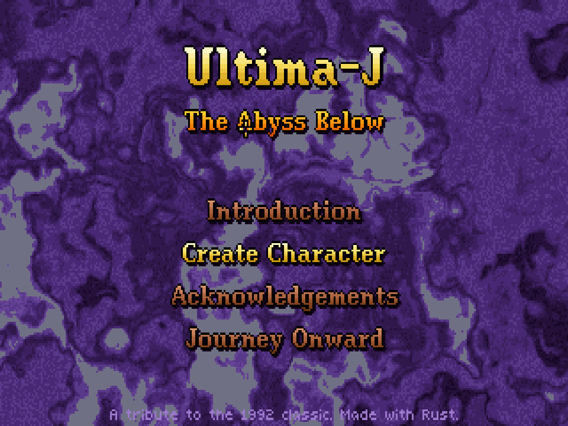
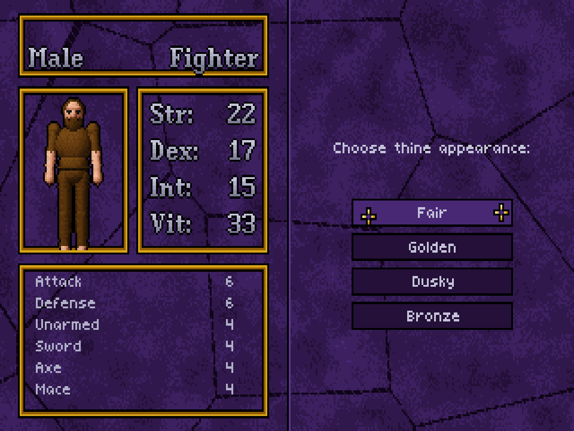
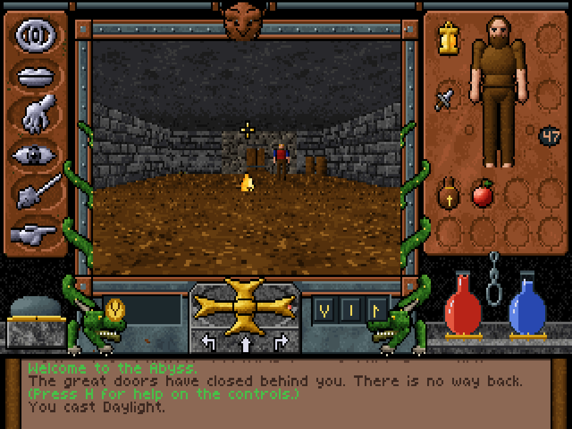
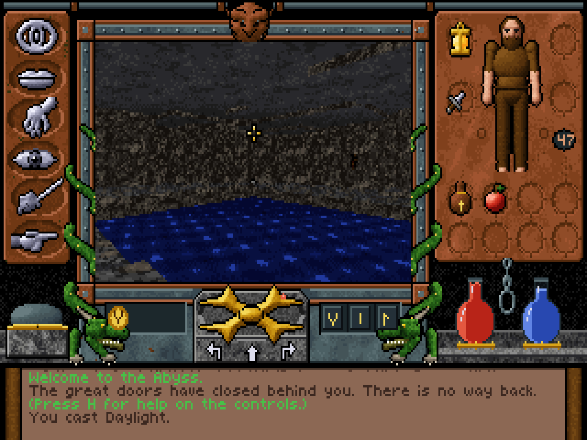
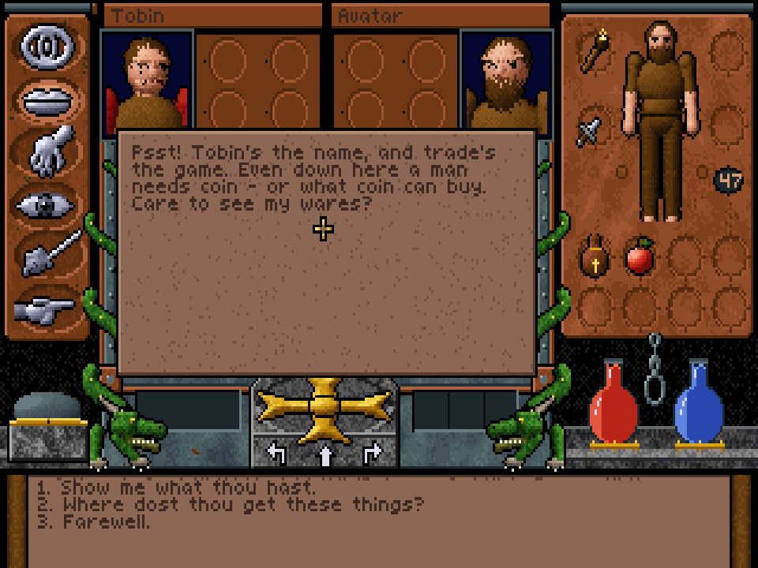
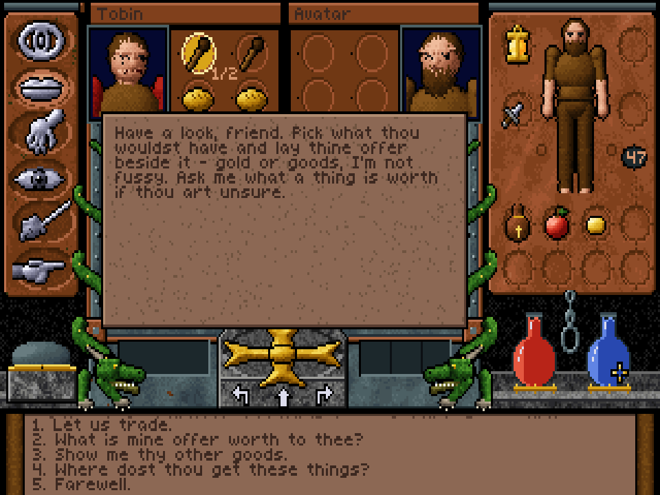
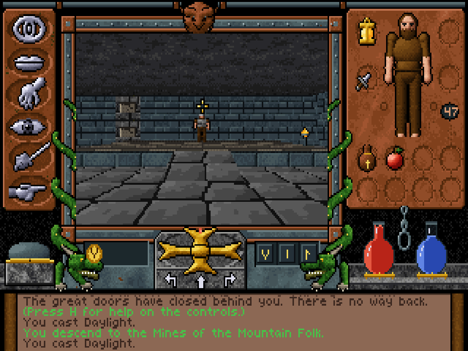
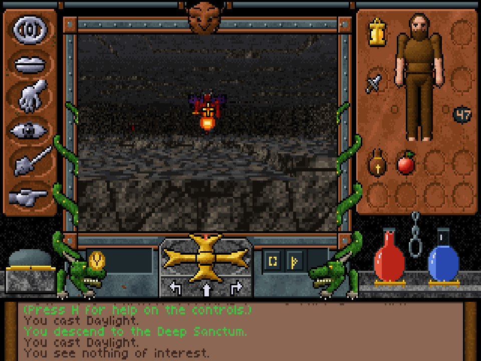
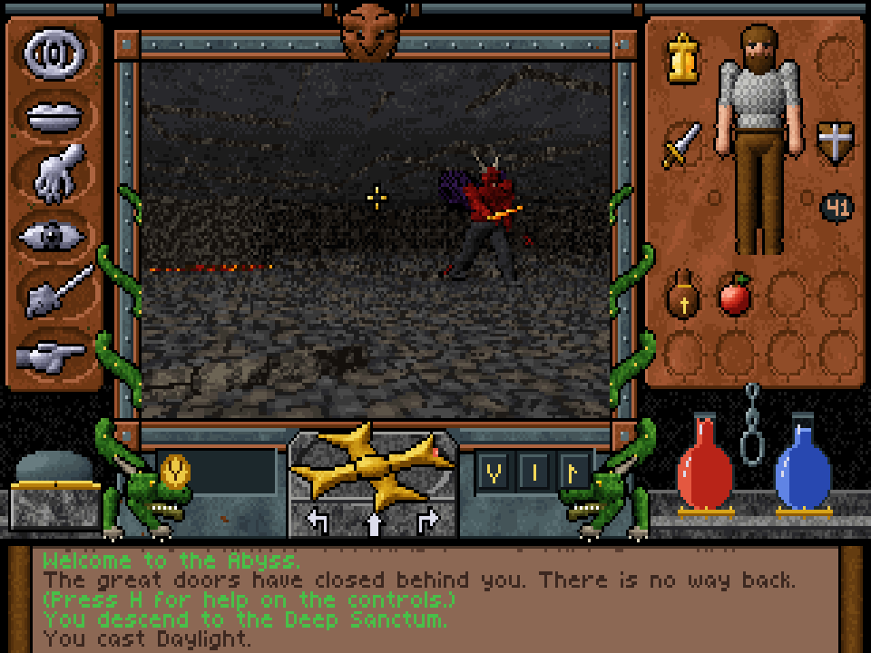
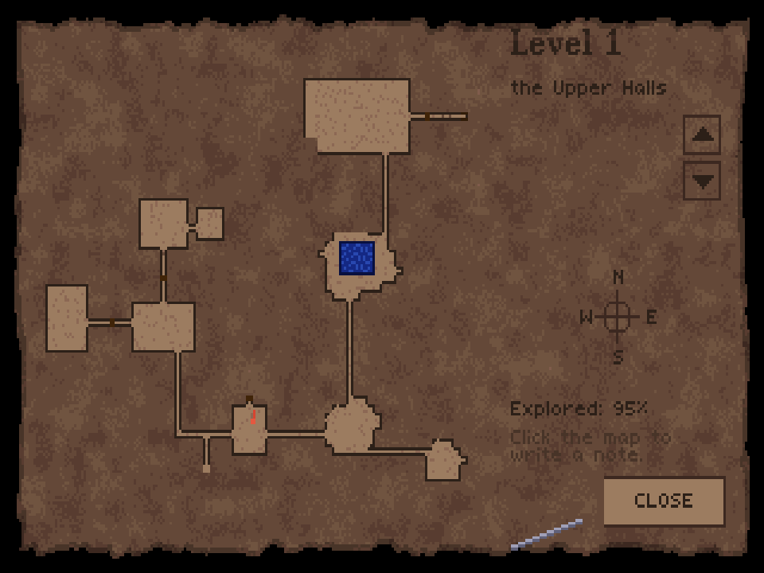

# Ultima-J: The Abyss Below

A clone of **Ultima Underworld: The Stygian Abyss** (1992), written in Rust.

It recreates the original's look and feel: a 320×200, 256-colour screen with the
ornate frame (command icons, gargoyle, dragons, compass, power gem, vitality and
mana flasks, rune shelf, message scroll), a texture-mapped 3D dungeon with real
height (slopes, steps, diagonal walls, water, lava), distance-faded torch light,
creatures seen from eight directions, a paperdoll inventory, rune magic,
conversations, an automap, and a five-level quest.

No original game data is used. Every texture, sprite, icon, font, sound and piece
of music is generated procedurally at start-up, styled after screenshots of the
original. The story and characters are original.

## Screenshots

| | |
| --- | --- |
|  |  |
|  |  |
|  |  |
|  |  |
|  |  |

## Building and running

Requires Rust (stable). From this directory:

```sh
cargo run --release            # title screen
cargo run --release -- --play  # skip straight into the dungeon
```

Saved games go to `~/.ultima-j/`.

## Controls

The controls follow the original's reference card.

| Action | Keys / mouse |
| --- | --- |
| Run / walk forward | `W` / `S` (or `Up`) |
| Back, turn, sidestep | `X`, `A`/`D` (or `Left`/`Right`), `Z`/`C` |
| Mouse movement | hold the left button in the view; the cursor arrow shows the direction, and further from the centre is faster |
| Jump | `J` or `Space` (or right button while moving) |
| Look down / centre / up | `1` / `2` / `3` |
| Fly up / down (when flying) | `E` / `Q` |
| Talk, Get, Look, Fight, Use | click an icon (or `F2`–`F6`), then right-click in the view |
| Default mode | right-click looks; hold/drag the right button to get, use or talk |
| Attack | in Fight mode hold the right button, watch the power gem, release; high bashes, middle slashes, low thrusts (keys `P`, `;`, `.`) |
| Inventory | left-click to pick up / put down; right-click to use (eat, drink, read, light, open, repair worn gear) |
| Barter | with a trader, click their goods (top left) to pick them, put gold or items from your inventory in your trade area (top right), then choose "Let us trade"; right-click either side to ask what a thing is worth |
| Statistics | click the pull chain (or `F7`); spend skill points after levelling up |
| Runes and spells | left-click the rune bag, click runes onto the shelf, click the shelf (or `F8`) to cast; right-click the shelf to clear it |
| Map | `M` or `Tab` |
| Track / sleep | `F9` / `F10` |
| Disarm a trap | once spotted, Use the floor tile it is on |
| Status | click the compass (condition), the flasks (vitality, mana) |
| Options, save, restore | `F1`/`Esc`; `Ctrl+S` quick-save, `Ctrl+R` restore |
| Help | `H` |
| Fullscreen / aspect | `F11` / `F12` (4:3 like a CRT, or square pixels) |

## Skills

All twenty skills do something. Besides the combat, magic and lock skills:

- **Lore** names an item's enchantment when you look at it.
- **Appraise** tells you what an item is worth and gets you better prices.
- **Charm** lowers prices and opens friendlier lines in conversation.
- **Repair** mends worn weapons and armour (use them from the inventory);
  the higher the skill, the closer to new.
- **Traps** spots hidden pressure plates as you approach (marked on the map)
  and disarms them.
- **Swimming** lets you swim faster, keep your head higher and carry more.
- **Acrobat** makes you jump higher and fall farther without harm.
- **Sneak** lets you get closer before creatures notice you.

## The quest

The wizard Malchor has carried Lady Rowena, daughter of Baron Aldwin, into the
Abyss. Thrown in after her, you must win the three shards of the Lumen Stone —
Valor from the mountain folk, Wisdom from the lizardmen, Mercy from the dead in
the crypts — and carry them into the Deep Sanctum, where Malchor means to wake
the Shadow Fiend.

## Differences from the original

Ultima-J copies the original's look and controls. The story, characters and
maps are new.

**Shared with the original:** the screen layout and visual style; movement,
the look/get/use/talk/fight icons, the paperdoll inventory, rune magic, the
automap with notes and sleeping with dream hints; and the basic setup, in which
you are thrown into an underground abyss to rescue a nobleman's kidnapped
daughter.

**Different:**

| | Ultima Underworld (1992) | Ultima-J |
| --- | --- | --- |
| Story | Baron Almric's daughter Arial is taken by Tyball; you have to stop the Slasher of Veils from being summoned | Baron Aldwin's daughter Lady Rowena is taken by the wizard Malchor; you have to stop him waking the Shadow Fiend |
| Goal | Collect the eight talismans of virtue and cast them into the volcano | Collect three shards of the Lumen Stone (Valor, Wisdom and Mercy) |
| Size | 8 levels | 5 levels: the Upper Halls, the Mines of the Mountain Folk, the Flooded Warrens, the Crypts and the Deep Sanctum |
| Characters | The original cast | New characters, among them Elsmore, Tobin, Gnarl, Rhugg, Thorgrim, Hilda, Bodric, Hissk, Ssrath and Sir Aldric |

Some ideas are borrowed loosely, such as goblins, dwarves (the "mountain folk"),
lizardmen and a crypt full of the dead, but the maps, conversations and quests
were written from scratch.

## Development tools

```sh
cargo test --release                          # unit tests, level connectivity, fuzzers
ultima-j --script "goto 18.5 41.5 270; tap F2; rclick 112 70; shot out.png"
                                              # drive the game headless (see src/headless.rs)
ultima-j --maps DIR                           # top-down renders of all levels
ultima-j --dump-art DIR                       # textures, frame, items, fixtures
ultima-j --creatures FILE                     # creature sprite sheet
ULTIMA_J_SELFTEST=out.png ultima-j --play     # capture the real window after 3 s
```

## Layout of the code

- `src/gfx` — palette and light tables, indexed bitmaps, fonts, the polygon/sprite rasteriser
- `src/render` — tile map to polygons, camera, 3D view
- `src/art` — procedural textures, UI frame, item icons, creature models and the sprite ray-caster
- `src/world`, `src/game` — map, items, creatures, AI and combat, magic, dialogue, levels
- `src/ui` — screens, main game screen, inventory panel, conversations, automap, menus
- `assets/dialogue.txt` — all conversations, in a small text format
